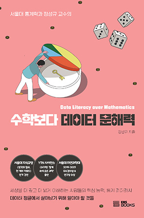
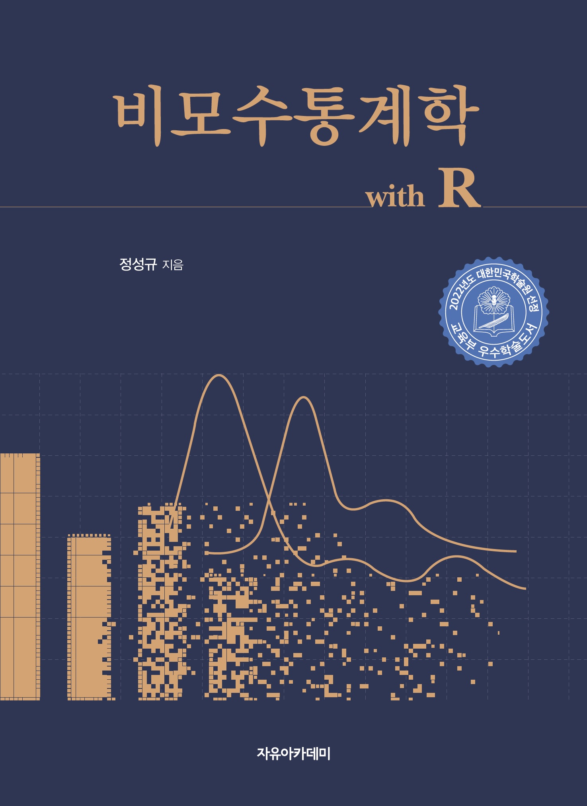
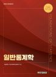

```{r setup, include=FALSE}
knitr::opts_chunk$set(echo = TRUE)
```


<!--html_preserve-->
<style type="text/css">
.main-container {
  max-width: 100%;
  margin-left: auto;
  margin-right: auto;
}
</style>

<style>
  .profile-img {
    width: 250px !important;
    vertical-align: middle;
    margin: 0px 20px;
    float: left; /* align="left" 대신 사용 */
  }
</style>

<div class="jumbotron">
    
    <div class="container">
      <p>Professor of Statistics</p>
      <p>Seoul National University</p>
      <p>Interested in statistical theory and methods for Non-Euclidean, High-Dimensional data analysis, and Data Privacy </p>
      <p><a class="btn btn-primary btn-lg" href="pubs.html" role="button">Publications</a>
      <a class="btn btn-primary btn-lg" href="TeachingPage.html" role="button">Courses</a>
      <a class="btn btn-primary btn-lg" href="https://statlet.github.io" role="button">Lab</a></p>
     
      
      
    </div>
    
    
    
    
</div>


<div class="container">
   <div class="row">
        <div class="col-md-8">
        	<h2>Brief Biography</h2>
          	<p> 
          	I am a Professor and Chair of <a href="https://stat.snu.ac.kr/en/">the Department of Statistics</a> at <a href="http://en.snu.ac.kr/">Seoul National University</a> and the founding director of the <a href="http://idis.snu.ac.kr/">Institute for Data Innovation in Science (IDIS)</a>. Before joining SNU, I spent seven years at the University of Pittsburgh, following my Ph.D. at the University of North Carolina at Chapel Hill. </p>
          	
          		<p>My research focuses on statistical theory and methods for non-Euclidean and high-dimensional data, with particular emphasis on the interplay between geometry and statistics. I study estimation, dimension reduction, and inference for data on manifolds and metric spaces, alongside high-dimensional classification and the integration of data from multiple sources. Recent interests include robust statistical methods, reliable prediction, and the statistical foundations of AI. Through interdisciplinary collaborations, I also work on AI for science, connecting statistical methodology with scientific questions and complex scientific data. Another strand of my research concerns data privacy, including differential privacy, synthetic data, and the assessment of their statistical utility and disclosure risks. Across these areas, I aim to develop methods that combine theoretical understanding with practical value for data analysis. </p>
 
<p> I have authored two books and coauthored one more, all in Korean: 

<a href="books.html#dataliteracy">
  
</a>
<a href="books.html#npbook">
  
</a>
<a href="books.html#FoS">
  
</a></p>

          	<!--	<p> <a href="http://science.snu.ac.kr/bbs/view.php?board_id=kor_profnews&idx=311&m=4&gul_no=6817&page=1">Interview article at College of Natural Science,Seoul National University (Oct. 10, 2018) in Korean</a></p>  -->
          		
          	<!--	<p> <a href="https://www.youtube.com/watch?v=WhlLZix8JPI">유튜브 홍보영상: 서울대 자연대 대학원에서 '연구뭐하지?' 통계학과 정성규 교수 연구실 Aug. 31, 2020) </a></p> -->
          	 
         


          		
     <!--   <p> - Last updated: `r tmp<-Sys.setlocale("LC_TIME", "C")` `r format(Sys.Date(), "%B %d, %Y")`</p>  	-->
			  </div>

        <div class="col-md-4">
   			</div>
		</div>
</div>
<!--/html_preserve-->

<!-- - Last updated: `r tmp<-Sys.setlocale("LC_TIME", "C")` `r format(Sys.Date(), "%B %d, %Y")`-->


<div class="container">
   <div class="row">
### Recent News [(More news)](news.html)

```{r, results='asis', echo=FALSE, comment=FALSE}
a = readLines("newslist.Rmd", n = -1)
n = length(a)
nullid = rep(1,n)
for(i in 1:n){if(identical("", a[i])){nullid[i] = 0}}
a = a[nullid == TRUE] 
n = length(a)
k = n
for(i in 1:n){if(identical("# BadNews", a[i])){k = i;break;}}
k = min(n,5)
for (i in 2:(k-1)) { 
  cat(paste(" - ", sep = "", a[i]))
  cat("\n\n")
}
```

- Last updated: `r tmp<-Sys.setlocale("LC_TIME", "C")` `r format(Sys.Date(), "%B %d, %Y")`        

</div>
</div>